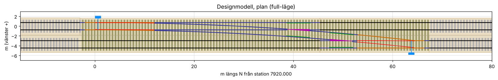

# Branschutmaningen 2026 – DGN-modellering och IFC 4.3-export i Bentley MicroStation

Lösningen bygger en tredimensionell, redigerbar **DGN-modell i MicroStation** av banöverbyggnaden (räler, slipers, ballast och spårväxlar) utifrån LandXML-linjeföringarna. Varje element får Item Types med IFC-klass, CoClass, Psets och Qtos. Modellen exporteras till **IFC 4.3 ADD2 med MicroStations egen IFC-exportör**, kompletteras vid behov i ett separat och uttryckligt efterbearbetningssteg och valideras mot original-IDS:en.

> **Status – läs detta först.** Utvecklingen skedde i en Linux-container utan MicroStation (`docs/evidence/environment_report_linux_container.json`). Kedjan har därefter körts av användaren i **MicroStation 2026**: DGN med 3 477 element och 0 fel, Bentleys IFC 4.3-export, efterbearbetning och IDS-validering. Med rättningarna efter den körningen ger samma export **17/22** IDS-specifikationer. De 5 underkända beror enbart på motsägelser i IDS:en, se [`docs/evidence/microstation2026_run1/`](docs/evidence/microstation2026_run1/). Allt som går att köra utan MicroStation är testat (55 automatiska tester). Bentley-API-anropen finns i `microstation/msapi.py` och är kontrollerade mot Bentleys API-referens. Det som måste provas inuti MicroStation står i [`docs/MicroStation_verifiering.md`](docs/MicroStation_verifiering.md).

## Arbetsflöde

```
input/ LandXML ─┐
config/*.yaml ──┼─> geometry/ + model/  (ren Python: spårgeometri, designmodell, mängder)
                │        │
                │        ▼
                │   microstation/build_railway_dgn.py  ── i MicroStation ──> output/Branschutmaningen_2026.dgn
                │        (nivåer, BU2026_IFC Item Types, Bentley "IFC Classification",      │  3D-solider, Item Types,
                │         DgnBox-/mesh-solider, Named Groups, GCS, kontroll, rapport)      │  Named Groups
                │                                                                          ▼
                │   microstation/export_ifc.py ─> MicroStations IFC-exportör (IFC 4.3) + export/SchemaMapping.json
                │                                                                          │
                │                                    output/Branschutmaningen_2026_bentley_export.ifc
                │                                                                          │
                │   export/inspect_bentley_export.py  (vilka klasser och relationer exportören skapade)
                └─> export/complete_ifc_structure.py (SEPARAT efterbearbetning, bara DGN-data + LandXML)
                                                                                           ▼
                    validation/validate_ifc.py (IfcTester, original-IDS) -> output/validation_report.html/.json
```

## Teknikval

* **Alternativ A, MicroStation Python API** (MSPyBentley, MSPyBentleyGeom, MSPyECObjects, MSPyDgnPlatform, MSPyMstnPlatform). Allt som behövs finns i Python-API:t: 3D-solider (`ISolidPrimitive.CreateDgnBox`, slutna `PolyfaceHeader`-nät via `DraftingElementSchema.ToElement`), nivåer (`FileLevelCache`), Item Types (`ItemTypeLibrary`, `CustomItemHost`), Named Groups, GCS (`DgnGCS`). Därför behövs ingen C#-AddIn (alternativ B). COM/VBA används inte.
* IFC 4.3-exporten görs med **MicroStation 2025:s iTwin IFC-exportör** (Technology Preview: File > Export > IFC, key-in `mdl load Bentley.Interchange.iTwinIFCExporter` + `IFC ITWINEXPORT`). Exportören har inget dokumenterat programmerbart API. `export_ifc.py` öppnar dialogen med de dokumenterade key-ins och skriver de exakta inställningarna. Inga GUI-makron med skärmkoordinater används.
* Ingen fristående IFC-generator ersätter MicroStation. Efterbearbetningen skapar ingen fysisk geometri.

## Projektstruktur

```
input/          originalunderlag (oförändrade, SHA256SUMS)
config/         model_config.yaml (all parametrisering), object_mapping.yaml (klassning, CoClass, Pset/Qto-typer), levels.yaml
common/         konfigurationsladdning, miniyaml (MicroStations Python saknar PyYAML)
geometry/       landxml_reader, alignment_math (linje/cirkel/klotoid), vertical_profile, cant, track (3D-ram), georef (SWEREF99 18 00)
model/          railway_model (spårdelar, räler, slipers, ballast), turnout (växelgenerator), geom (solider, mängder), components
microstation/   build_railway_dgn.py (huvudskript), msapi.py (alla Bentley-anrop), backend.py (+ inspelande backend för torrkörning),
                create_itemtypes / assign_metadata / create_levels / create_rails / create_sleepers / create_ballast /
                create_turnout / create_spatial / dgn_geometry, prepare_dgn, inspect_environment, export_ifc
export/         SchemaMapping.json, build_schema_mapping.py, inspect_bentley_export.py, complete_ifc_structure.py, README.md
validation/     validate_ifc.py (IDS, HTML/JSON), validate_dgn.py (DGN mot designmodell), ids_conflicts.py
tests/          51 pytest-tester (+ tests/fixtures/simulated_export.py = SIMULERAD export, inte Bentley)
tools/          plot_design_model.py (plankontroll), make_docs.py (genererar kravmatris och geometrirapport)
docs/           Kravmatris, konflikter, körinstruktion, verifieringslista, IFC-relationer, geometriverifiering
output/         resultat från körningarna (kan checkas in för granskning)
```

## Snabbstart utan MicroStation

```bash
python -m pip install -r requirements.txt
python -m pytest -q                                              # 55 tester
python microstation/build_railway_dgn.py --dry-run --mode preview  # hela orkestreringen, ingen DGN skrivs
python validation/validate_dgn.py --dry-run
python tools/plot_design_model.py --mode full --out docs/img/vaxelforbindelse_plan.png
python validation/ids_conflicts.py                               # motsägelser i original-IDS
python tools/make_docs.py --pipeline-check                       # kravmatris + geometriverifiering
```

## Körning i MicroStation

Se [`docs/Korinstruktion_MicroStation.md`](docs/Korinstruktion_MicroStation.md). Kort version:

```
python microstation\prepare_dgn.py                                   (seed -> output\Branschutmaningen_2026.dgn, öppna filen)
python load "<repo>\microstation\inspect_environment.py"             (steg 1: miljö, API, exportörens filer)
python load "<repo>\microstation\build_railway_dgn.py"               (mode: preview | full i config)
python load "<repo>\validation\validate_dgn.py"
python export\build_schema_mapping.py --template output\env\<standardfil>.json
python load "<repo>\microstation\export_ifc.py"                      (öppnar exportdialogen: IFC 4.3, SchemaMapping)
python export\inspect_bentley_export.py
python export\complete_ifc_structure.py
python validation\validate_ifc.py
```

## Modellen

**Geometri** (detaljer och siffror i [`docs/Geometri_verifiering.md`](docs/Geometri_verifiering.md)):
* LandXML läses med rätt koordinatordning (Northing Easting) och stationering från filen. Alla 27 horisontalelement (linje, cirkelbåge, klotoid) återskapar filens slutpunkter inom 0,002 mm.
* Vertikalprofil med paraboliska vertikalkurvor och rälsförhöjning (rotation kring innerräl). Varje station ger X, Y, Z, tangent, sidovektor, normal, lutning, förhöjning och lokal rotationsmatris (`geometry/track.py`).
* SWEREF 99 18 00 / RH 2000. RefLatitude/RefLongitude räknas fram med Gauss–Krüger och stämmer med pyproj på 1e-11°.

**Objekt** (full-läge): 6 spårdelar (4 × PLAINTRACK, 2 × TURNOUTTRACK), 16 + 16 räler (60E1-profil, uppdelade per kurvzon i innerräl/ytterräl), 3 292 + 117 slipers (DgnBox, c/c 0,60 m, följer lutning och förhöjning), 6 ballastkroppar (släntlutning, delade vid mittlinjen mellan spåren), samt per växel 2 stödräler, 2 tungor, 2 moträler, 1 korsning och 1 omläggningsanordning. Dessutom 3 linjeföringar (3D-linjesträngar) och bärarelement för Project/Site/Railway/RailwayPart/SpatialZone/BuiltSystem.

**Växelförbindelsen** beräknas ur geometrin (`model/turnout.py`): tungspets, korsning som verklig räl–räl-skärning (A: 1:13,7 vid N 7961,06; B: 1:11,3 vid S 7965,26), gemensamma långslipers i förbindelsezonen.



**DGN-struktur:** nivåerna `BU26_ALIGNMENT`, `BU26_RAIL_MAIN`, `BU26_RAIL_STOCK`, `BU26_RAIL_CHECK`, `BU26_FROG`, `BU26_SLEEPER`, `BU26_SLEEPER_TURNOUT`, `BU26_BALLAST`, `BU26_SWITCH_ASSEMBLY`, `BU26_SPATIAL`, `BU26_REFERENCE` med egna färger. Named Groups per spårdel, per växel och för spårsystemet. **IFC-klassen beror aldrig på nivån.**

**Item Types** (bibliotek `BU2026_IFC`, `microstation/create_itemtypes.py`):
`BU26_Object` (objekt-ID, kategori, IFC-entitet, PredefinedType, Name, Description, LongName, ObjectType, rumslig förälder och relation, RailwayPart-ID, Alignment-ID, start- och slutstation, spår, sida, inner/ytterräl, växel, grupper, material, Phase, UsageType, Ref-lat/long/elev, läge), `BU26_Classification` (två CoClass-referenser), `Pset_RailwayTrackStructurePart`, `Pset_BuiltSystemRailwayTrack`, `Pset_ElementAssemblyTypeTractionSwitchingAssembly`, `Pset_SpaceCommon`, `Pset_CourseCommon`, `Pset_TrackElementOccurrenceSleeper`, `Qto_CourseBaseQuantities`, `Qto_SleeperBaseQuantities`. Dessutom fylls Bentleys levererade **IFC Classification** (Version/Class/Type) i. Mängderna räknas ur samma geometri som skrivs till DGN:en (GrossVolume = solidens volym, Volume = GrossVolume − inbäddade slipers, Weight = Volume × densitet).

## IFC-export, relationer och validering

* `export/SchemaMapping.json`: Bentley-format. Bara de offentligt dokumenterade sektionerna finns med; byggaren slår ihop dem med exportörens standardfil. Se [`export/README.md`](export/README.md).
* Rumslig struktur och relationer, och vem som skapar vad: [`docs/IFC_relationer.md`](docs/IFC_relationer.md).
* Kravmatris IDS → DGN-objekt → Item Type → IFC-mappning → förväntat resultat: [`docs/Kravmatris.md`](docs/Kravmatris.md).
* Motsägelser i underlagen: [`docs/IDS_och_underlag_konflikter.md`](docs/IDS_och_underlag_konflikter.md). Original-IDS:en kräver att **alla** `IfcRail.RAIL` har Description "innerräl" (#7) **och** "ytterräl" (#16), ligger i PLAINTRACK (#7/#16) **och** i TURNOUTTRACK (#10). Alla slipers ska ligga i PLAINTRACK (#9) **och** TURNOUTTRACK (#17). Högst 17/22 specifikationer kan därför godkännas.

**Testresultat på simulerad export (inte MicroStation):** Exportkedjan har provats på en IFC från `tests/fixtures/simulated_export.py`, som efterliknar en generisk export med Item Types som otypade Psets, alla element i IfcSite och i värsta fall alla som proxys med lokalt origo. Den råa filen klarar 1/22 IDS-specifikationer. Efter `complete_ifc_structure.py` klaras **17/22**. De fem underkända (#7, #9, #10, #16, #17) underkänns enbart på grund av IDS-motsägelserna. Inga proxys finns kvar, `ifcopenshell.validate` ger 0 schemafel och IfcAlignment-geometrin stämmer med LandXML på millimetern. Den verkliga statusen för en MicroStation-export ges av `validation/validate_ifc.py` efter export.

## Konfiguration

`config/model_config.yaml` styr allt utan kodändring: LandXML-, IDS-, seed- och utfiler, koordinatsystem, projekt-, site-, railway-, zon- och systemdata, linjeföringar, spårdelarnas indelning (eller explicita stationsgränser), spårvidd och rälmittavstånd, rälprofiler, slipers (c/c, mått, material, växelslipers), ballast (överbredd, tjocklek, släntlutning, densitet, delning mellan spåren), växelparametrar (tunglängd, korsningslängd, moträl, fårbredd, växeldriv inkl. 400 V/1200 W), vertikalkurvtolkning, förbindelsens profil, samplingstolerans per läge (preview/full), solidtyp i DGN och detaljnivå. Nivåer och symbologi finns i `config/levels.yaml`, klassning, CoClass och Pset/Qto-datatyper i `config/object_mapping.yaml`.

## Begränsningar

* Inget av MicroStation-stegen har körts här (se status ovan och verifieringslistan V-01–V-17).
* Exportörens hantering av spatiala klasser, Item Types och relationer är inte känd i förväg. `inspect_bentley_export.py` mäter den och efterbearbetningen kompletterar.
* Växelns komponenter är konstruktivt förenklade (tungor som avsmalnande profiler, korsning som kil). Förbindelsens fiktiva geometri (anslutning i vinkel mot S, höjdsprång 0,228 m) hanteras som beskrivet i konfliktdokumentet.
* Civila alignment-objekt (OpenRail) skapas inte. I DGN:en finns linjeföringarna som 3D-linjesträngar med metadata, och i IFC som IfcAlignment med full semantik från LandXML.

## Källor (Bentley)

* MicroStation Python API: https://developer.bentley.com/documentation/microstation-python-api/ (API-referens, guider, presentationer 06 och 24)
* MicroStation 2025-hjälp: "(Technology Preview) To export DGN file to IFC format", "(Technology Preview) To Import and Attach IFC-related Item Types…", "To execute the compiled Python file using the Key-in dialog"
* OpenRail Designer-hjälp: "Export to IFC" (IFC Classification Item Type, proxy-beteende)
* Bentley Communities: "Default Schema mapping for Export to IFC", version 1–7 (GlobalVariables, ProjectConfigurations, IFCDynamic-klassposter)
